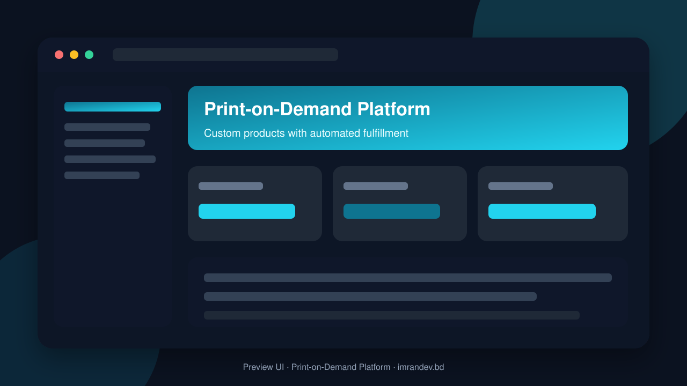
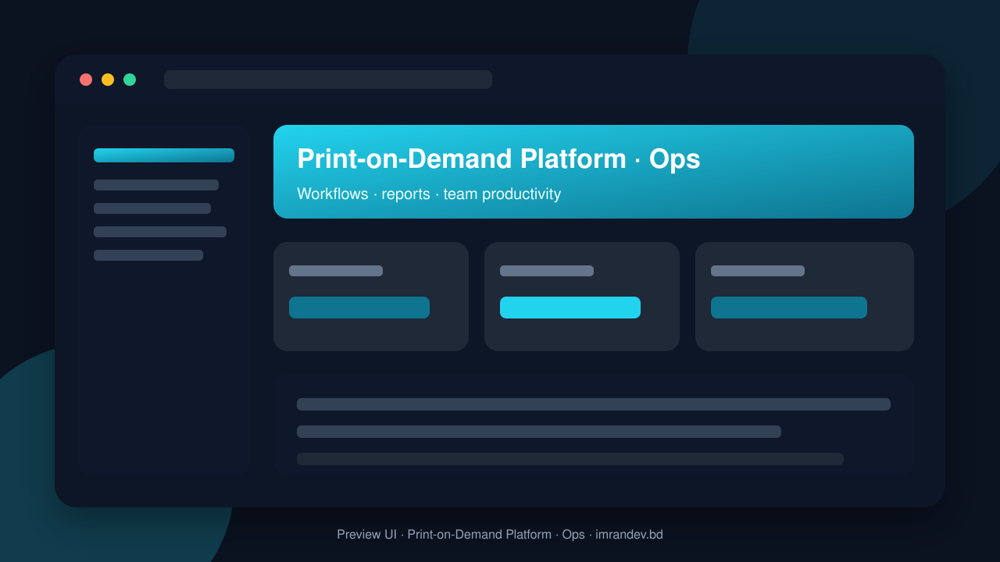

<p align="center">
  
</p>

<h1 align="center">Print-on-Demand Platform</h1>

<p align="center"><strong>Custom products with automated fulfillment</strong></p>

<p align="center">
  <a href="https://github.com/imranbru99/print-on-demand-platform-fulfillment"></a>
  
  
</p>

---

## Overview

**Print-on-Demand Platform** is a complete business application focused on real operational workflows. This README lists the full feature surface so GitHub visitors and search engines can understand every capability of the product.

## Product preview

| Dashboard | Operations |
| :---: | :---: |
|  |  |

## Complete feature list

### Product modules & capabilities

- Build a Complete Enterprise-Grade Print-on-Demand SaaS Platform
- E-commerce Engineer
- Print Production Management Specialist
- AI Integration Engineer
- DevOps Engineer
- Security Engineer
- QA Automation Engineer
- Required module management functionality
- Production Manager
- Orders
- Inventory
- Customer portal
- Security tests

### Admin / Filament resources

- Audit Log
- Automation Workflow
- Blog Post
- Campaign
- Category
- Cms Page
- Coupon
- Customer
- Design Asset
- Employee
- Expense
- Faq
- Fulfillment Order
- Inventory Item
- Invoice
- Mockup
- Module Registry
- Order
- Plan
- Product
- Production Job
- Production Order
- Quality Check
- Return
- Shipment
- Store
- Subscription
- Support Ticket
- Tenant
- User
- Warehouse

### Domain models

- Ai Provider Setting
- Api Key
- Audit Log
- Automation Execution
- Automation Workflow
- Belongs To Tenant
- Blog Post
- Campaign
- Cart
- Cart Item
- Cms Page
- Coupon
- Customer
- Customer Address
- Department
- Design Asset
- Design Version
- Employee
- Expense
- Faq
- Feature Flag
- Financial Transaction
- Fulfillment Order
- Integration
- Integration Log
- Inventory Item
- Invoice
- Knowledge Article
- Mockup
- Module Dependency
- Module Registry
- Order
- Order Address
- Order Event
- Order Item
- Order Note
- Order Return
- Payment
- Payment Transaction
- Plan
- Platform Setting
- Print Area
- Print Provider
- Product
- Product Attribute
- Product Category
- Product Image
- Product Pricing
- Product Variant
- Production Assignment

### HTTP / API controllers

- Auth APIs & screens
- Blog APIs & screens
- Cart APIs & screens
- Category APIs & screens
- Checkout APIs & screens
- Coupon APIs & screens
- Feature APIs & screens
- Home APIs & screens
- Module APIs & screens
- Order APIs & screens
- Page APIs & screens
- Payment Sandbox Webhook APIs & screens
- Product APIs & screens
- Provider Mock Webhook APIs & screens
- Shop APIs & screens
- Store Account APIs & screens
- Store APIs & screens
- Store Home APIs & screens

### Detailed feature requirements delivered

- Project: Print-on-Demand Platform
- Application Type: Multi-Tenant SaaS + E-commerce + Print Production + Automated Fulfillment
- Backend: PHP 8.3+ / Laravel
- Administration: Laravel Filament
- Architecture: Modular, Multi-Tenant, API-First
- Objective: Build a complete, scalable, international Print-on-Demand business management ecosystem.
- ROLE AND MISSION
- Most important instruction: Build actual working functionality, not just attractive screens.
- REQUIRED TECHNOLOGY STACK
- REQUIRED PACKAGES
- Important: Verify PHP and Laravel compatibility before installation.
- APPLICATION ARCHITECTURE
- Layer A: Platform Administration
- Layer B: Business Administration
- Layer C: Customer and Public Storefront
- MULTI-TENANT SAAS SYSTEM
- USER TYPES AND ROLE MANAGEMENT
- MODULAR FEATURE MANAGEMENT SYSTEM
- COMPLETE BUSINESS MODULES
- MODULE 1: Business Dashboard
- MODULE 2: Product Catalog Management
- MODULE 3: Print-on-Demand Product Management
- MODULE 4: Product Customization Studio
- MODULE 5: Mockup Generator
- MODULE 6: Product Pricing Engine
- MODULE 7: Design Asset Library
- MODULE 8: Print Provider Management
- MODULE 9: Store Management
- MODULE 10: E-commerce Storefront
- MODULE 11: Sales Channel Integrations
- MODULE 12: Shopping Cart and Checkout
- MODULE 13: Payment Management
- MODULE 14: Order Management
- MODULE 15: Production Management
- MODULE 16: Quality Control
- MODULE 17: Fulfillment Management
- MODULE 18: Shipping Management
- MODULE 19: Inventory and Warehouse Management
- MODULE 20: Returns and Refund Management
- MODULE 21: Customer Relationship Management
- MODULE 22: Marketing Management
- MODULE 23: SEO Management
- MODULE 24: Content Management System
- MODULE 25: Financial Management
- MODULE 26: Subscription and SaaS Billing
- MODULE 27: Analytics and Reporting
- MODULE 28: AI Business Assistant
- MODULE 29: Staff and Attendance
- MODULE 30: Customer Support
- MODULE 31: Automation and Workflow Engine
- MODULE 32: Notifications
- MODULE 33: API and Webhook Management
- MODULE 34: White-Label and Enterprise
- PUBLIC WEBSITE AND MARKETING PAGES
- DATABASE ARCHITECTURE
- FILAMENT ADMINISTRATION DESIGN
- UI/UX REQUIREMENTS
- SECURITY REQUIREMENTS
- PERFORMANCE AND SCALABILITY
- AUTOMATED BUSINESS WORKFLOWS
- Workflow A: New business registration
- Workflow B: Product creation
- Workflow C: Customer purchase
- Workflow D: Automated production
- Workflow E: Fulfillment and delivery
- Workflow F: Returns
- API ARCHITECTURE
- REQUIRED DOCUMENTATION
- TESTING AND QUALITY ASSURANCE
- DEPLOYMENT AND PRODUCTION READINESS

### Platform capabilities

- Multi-role ready structure for operators, managers and admins
- Database migrations and seeders for demo-ready local setup
- Laravel architecture with services/controllers/models separation
- Responsive UI foundation (Blade / Filament where enabled)
- Environment-based config for local and production databases
- GitHub-ready documentation with visual product previews

## Tech stack

- PHP 8.2+ / Laravel
- Filament admin resources (where enabled)
- Vite asset pipeline
- SQLite/MySQL-ready database layer
- Migrations, seeders, and test-ready structure

## Quick start

```bash
git clone https://github.com/imranbru99/print-on-demand-platform-fulfillment.git
cd print-on-demand-platform-fulfillment
composer install
cp .env.example .env
php artisan key:generate
php artisan migrate --seed
npm install && npm run build
php artisan serve
```

## Repository

- GitHub: https://github.com/imranbru99/print-on-demand-platform-fulfillment
- Developer: **Imran Ahmed** · https://imrandev.bd

---

## 🤝 Let's Connect & Collaborate

I am open to **Senior Remote Full-Stack Roles**, AI Platform Architecture Contracts, and Enterprise Technical Advisory.

**Timezone:** UTC+6 (Dhaka / Rangpur, Bangladesh) — flexible overlap with US, UK & EU hours.  
**Delivery:** Async-ready · Slack · Discord · Jira · GitHub · production-first accountability.

| Channel | Handle | Link |
| :--- | :--- | :--- |
| Portfolio | imrandev.bd | https://imrandev.bd |
| Packagist | imrandevbd | https://packagist.org/packages/imrandevbd/ |
| LinkedIn | imranbru99 | https://linkedin.com/in/imranbru99 |
| GitHub | imranbru99 | https://github.com/imranbru99 |
| WhatsApp | +880 1576-918420 | https://wa.me/8801576918420 |
| Email | me@imrandev.bd | mailto:me@imrandev.bd |
| X | @imrandev_bd | https://x.com/imrandev_bd |
| YouTube | @ImranDevBD | https://youtube.com/@ImranDevBD |
