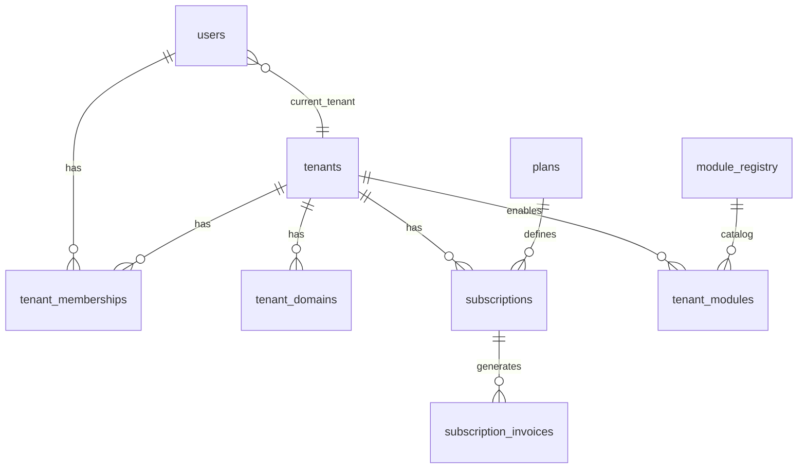
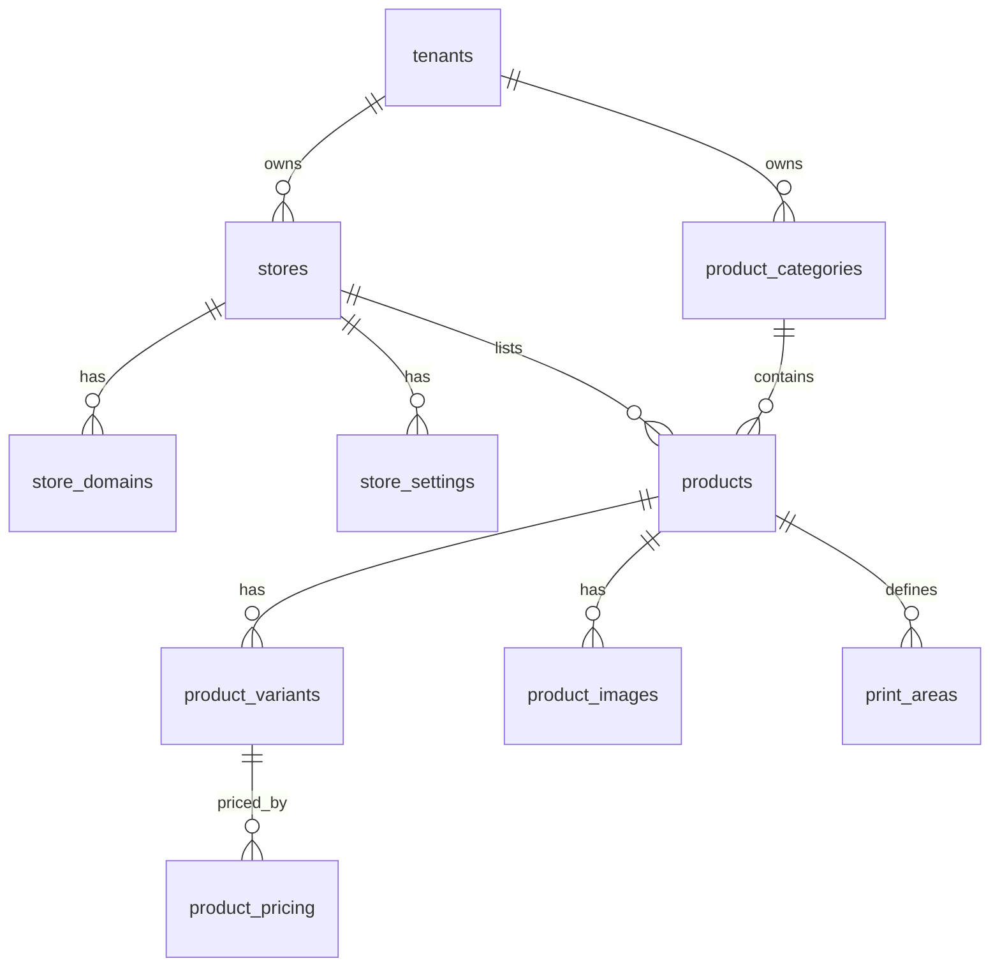
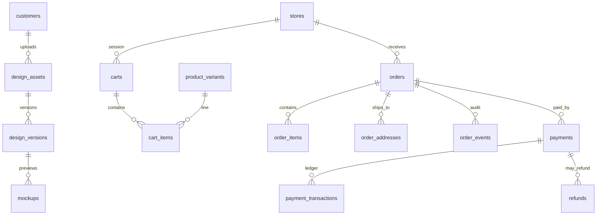
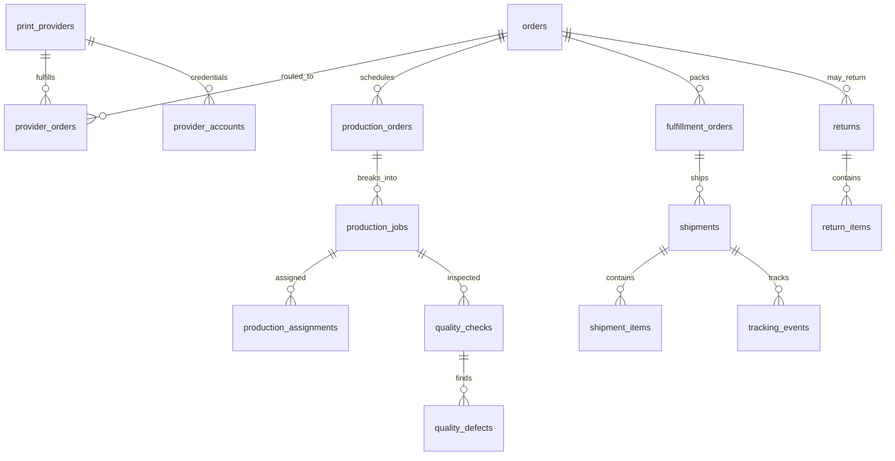
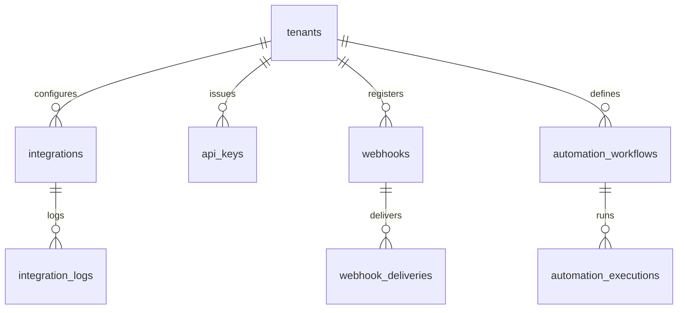

# Entity relationship diagrams

Core POD entities (simplified). All major business tables include `tenant_id` unless noted as platform-global.

## Tenancy & billing

## Store & catalog

## Design → cart → order

## Production & fulfillment

## Integrations

